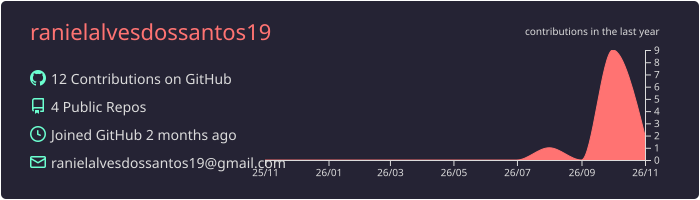
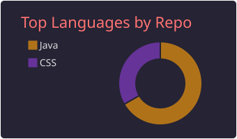
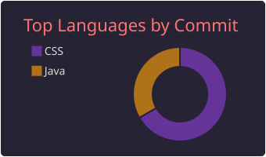
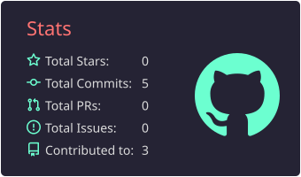
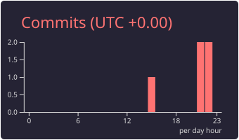

# 💻 Raniel Alves

**`Estudante de Desenvolvimento de Sistemas`**

Me chamo Raniel Alves dos Santos, tenho 40 anos e sou natural de São Paulo - SP. Atualmente estou cursando o 4º semestre do curso tecnólogo em Análise e Desenvolvimento de Sistemas pela Faculdade Anhanguera, e o 2º semestre do curso técnico em Desenvolvimento de Sistemas pela CEP - Escola Técnica de Santa Maria - DF. 

Apaixonado por tecnologia e em constante aprendizado, estou construindo minha trajetória na área de desenvolvimento de software, explorando novas ferramentas, aprimorando minhas habilidades e transformando conhecimentos em projetos práticos.

💻 Aqui compartilho meus estudos, projetos e minha evolução como desenvolvedor.

🚀 Sempre buscando aprender, evoluir e criar soluções por meio da tecnologia!

---

### 🤖 Linguagens e Tecnologias

 
 
 
 

### 📊 Estatísticas

 
 
